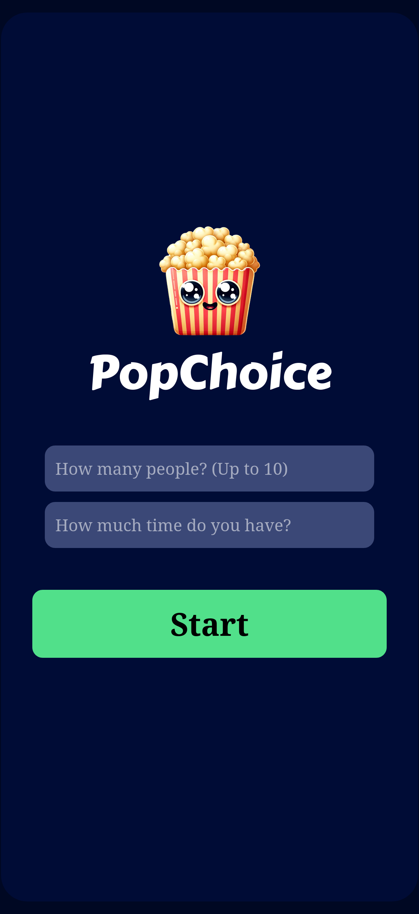
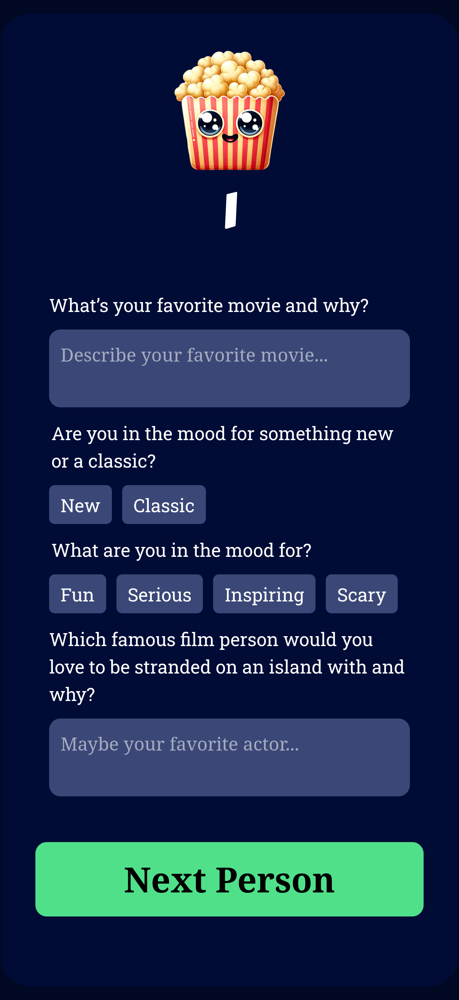
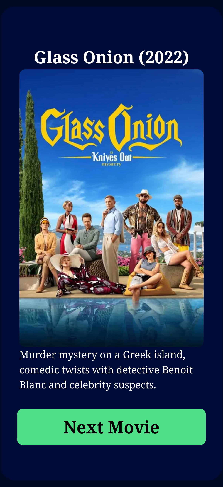

# PopChoice

This project is my attempt at [Scrimba](https://scrimba.com)'s solo project of the same name. The goal of the project is to build an AI-driven movie recommendation app. It uses RAG (Retrieval-Augmented Generation) to enhance the LLM's knowledge about current movies. The project uses the native HTML `<form>` element with React 19's new `useActionState` hook for native accessibility and loading state.

## User Flow

The user will be asked to fill in a form about their movie preferences. The form will be validated and sent to the server.

<figure>
    

        
        
    

    <figcaption style="text-align:center">The question form</figcaption>
</figure>

Then, the answers will be transformed into a vector embedding. The server will then use the embedding to fetch a list of relevant movies from the pre-seeded Supabase table. The information related to these movies will be sent to an LLM to determine the best choice for the user. The LLM will return an array of movie objects. Each object will contain a title, a release year, and a description. The description will be based on the user's prompt and the Supabase results. The server will validate the LLM output and attach a poster to each object using the TMDB API.

<figure>
    

        
    

    <figcaption style="text-align:center">The movie recommended</figcaption>
</figure>

## Installation

0. Prerequisites: You will need a Supabase account, an OpenAI-compatible API key, and a TMDB API key.
1. Create a Supabase database with the [vector extension](https://supabase.com/docs/guides/ai/vector-columns). Then, initiate a table with id, content, and embedding columns.
2. Create a `.env` file in `./backend` and fill in the required API keys, following the `.env.example` file.
3. Seed the table with `npm run seed`.
4. Add the [match_documents](https://supabase.com/docs/guides/ai/vector-columns#querying-a-vector--embedding) function to Supabase's SQL editor. Make sure the vector count matches your embedding model's output.
5. Run `docker compose up --build`. The app will be available at http://localhost:3000

6. (optional) Modify `shared/const.ts` for more precise matching. Due to the limited available data, a high `VECTOR_DB_THRESHOLD` might result in zero matching movies.

## Stack

**Frontend**:

- React 19 - UI
- CSS - styling

**Backend**:

- Express - Both API server and serving built React app.
- Supabase - embedding database
- OpenAI SDK - creating embedding and LLM response

**Misc**

- Zod - Data validation
- Vitest, MSW - testing
- TypeScript
- Docker

## Disclaimer

The app is for exploration purposes only. The movie data is retrieved from Scrimba.com.
